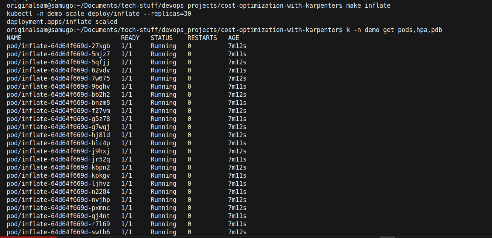
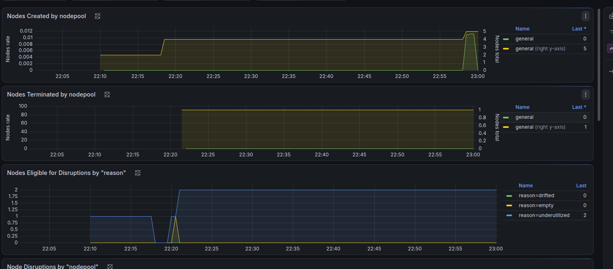
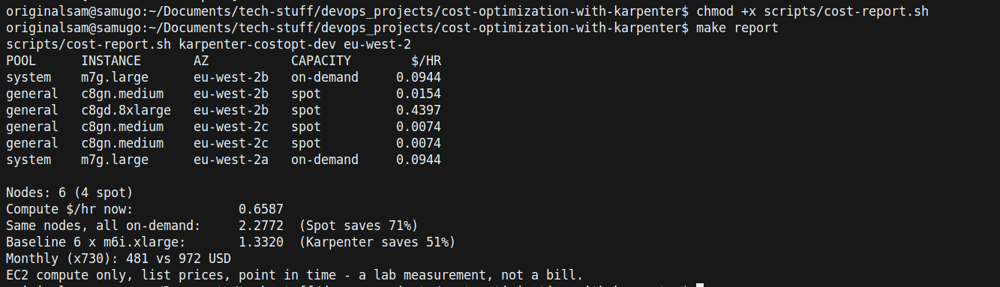
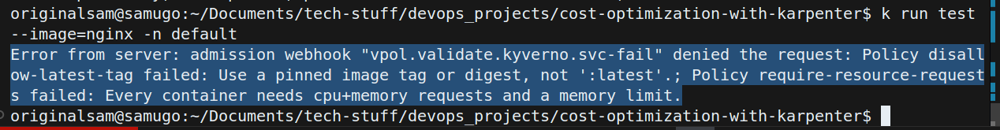
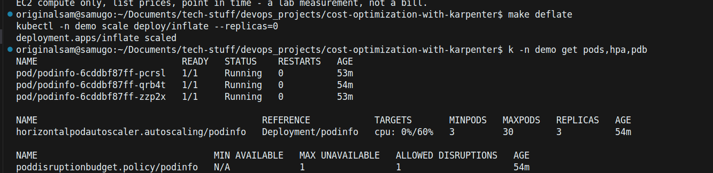

# Project write-up: EKS cost optimisation with Karpenter

## What I set out to achieve

Kubernetes clusters are usually the largest line on a team's cloud bill, and most of that is idle capacity: fixed node groups sized for peak load, running on-demand instances around the clock. I wanted to show that a cluster can buy compute only when workloads need it, on the cheapest capacity that fits, **without giving up reliability or security**.

Goals:

1. **Cut compute cost** against a typical static setup (6 × m6i.xlarge on-demand) using Spot, Graviton, right-sizing and consolidation, and **measure** the saving rather than claim it. *Achieved: 51% cheaper than the baseline at peak, with Spot alone saving 71%.*
2. **Keep it safe to run on Spot**: workloads survive node interruptions and replacements.
3. **Build security in from the start**, not bolt it on: no stored cloud keys, least-privilege CI, encrypted state and secrets, admission policies, network policies.
4. **Make everything reproducible**: infrastructure as code, one command per step, a teardown that leaves nothing billing.

## Result

Measured with `make report` during the burst demo (`make inflate`: 30 pods × 1 vCPU), eu-west-2, 26 November 2026:

| Measure | Value |
|---|---|
| Nodes running | 6: 2 on-demand system nodes + 4 Karpenter Spot nodes |
| Compute cost, Karpenter | **$0.66/hour** (~$481/month) |
| Same 6 nodes, all on-demand | $2.28/hour → **Spot saves 71%** |
| Static baseline, 6 × m6i.xlarge on-demand | $1.33/hour (~$972/month) → **Karpenter saves 51%** |

What the numbers show:

- **Karpenter chose a mix the baseline can't**: one 32-vCPU `c8gd.8xlarge` to pack most of the 30 inflate pods, plus three 1-vCPU `c8gn.medium` nodes for smaller pods. All are Graviton (ARM), all Spot, across two AZs. Nobody configured those instance types; Karpenter picked them from the allowed families.
- **More capacity for less money.** The cluster ran about 39 vCPU against the baseline's 24, yet cost half as much. Spot prices for the same instance type differed between AZs (`c8gn.medium`: $0.0154 in 2b vs $0.0074 in 2c), which is why a wide instance and zone menu matters.
- **The two system nodes are now the biggest fixed cost** ($0.19/hour of the $0.66). They are on-demand by design, so a Savings Plan is the next lever (see improvements).
- **Caveats:** EC2 compute only, list prices, at one moment. EBS, NAT, the EKS control plane and data transfer are excluded, and Spot prices move hourly. After `make deflate`, consolidation removes the Spot nodes, so the cost falls with demand; the static baseline does not.

## What I built

<!-- Optional: export a diagram, or keep the text diagram from the README -->

### 1. Foundations: state and CI identity (`terraform/bootstrap`)

A small Terraform stack, run once with local state, creates an **S3 bucket for Terraform state** (customer-managed KMS key, versioning, TLS-only policy, native S3 locking) and a **GitHub OIDC trust** with two IAM roles:

- a **plan role** for pull requests: read-only, with explicit denies so it cannot read secrets or data, or write state;
- an **apply role** usable only by a GitHub Environment with a required reviewer, with explicit denies on backdoors (IAM users, access keys) and audit tampering.

No AWS access keys exist anywhere.

### 2. Network and cluster (`terraform/envs/dev`)

- **VPC** across 3 AZs: private subnets for nodes, intra subnets (no internet route) for the control plane, a single NAT gateway, VPC flow logs, a locked-down default security group, and a free S3 gateway endpoint to cut NAT charges on image pulls.
- **EKS 1.35** with access entries instead of the `aws-auth` ConfigMap (and no implicit creator admin), KMS envelope encryption of Secrets, all control-plane logs, the API endpoint restricted to my IP, and VPC CNI network policy enforcement.
- A small **system node group** (2 × Bottlerocket ARM, tainted, on-demand) that runs Karpenter and the other critical controllers, so a Spot reclaim can never take out the autoscaler.
- **Karpenter's AWS side**: controller role via EKS Pod Identity, node role, and an SQS queue fed by EventBridge with Spot interruption warnings.
- Account guardrails: EBS encryption by default and a monthly **AWS Budget** alert.

### 3. Node provisioning (`platform/karpenter`)

Two NodePools sharing one EC2NodeClass (Bottlerocket, IMDSv2 hop limit 1, encrypted gp3, tag-based subnet discovery):

- **`general`**: Spot first with on-demand fallback, ARM and x86, families c/m/r generation 6+, up to 32 vCPU per node, hard CPU/memory limits as a cost ceiling, and `WhenEmptyOrUnderutilized` consolidation with a 20% disruption budget.
- **`critical`**: on-demand only, tainted so workloads must opt in, conservative `Balanced` consolidation and a business-hours freeze on cost and patching moves.

Nodes expire after 30 days, so the fleet is always on recent, patched images.

### 4. Guardrails (`platform/kyverno`)

Three Kyverno CEL `ValidatingPolicy` rules, enforced at admission **and** in CI with the Kyverno CLI:

1. Every container needs CPU and memory **requests** and a memory limit, because Karpenter sizes nodes from requests.
2. **No `:latest`** images, because constantly replaced nodes re-pull images and would roll in untested code.
3. Only namespaces labelled for it may use the **expensive on-demand pool** (including the "tolerate everything" bypass).

### 5. Proof (`platform/monitoring`, `scripts/cost-report.sh`)

- kube-prometheus-stack with the official **Karpenter dashboard** in Grafana and three alerts: pool near its limit, high node churn, pods pending too long.
- **OpenCost** for cost per namespace and team label.
- A **cost report script** that prices every running node at live Spot or on-demand rates and compares it with the static baseline.

### 6. Workloads (`k8s/`)

- **podinfo**, a small web service, deployed the way a production service on Spot should be: 3–30 replicas via HPA, spread across zones, a PodDisruptionBudget, a preStop delay for graceful draining, restricted Pod Security, read-only filesystem and default-deny network policy.
- **inflate**, a deployment of idle pods that reserve 1 vCPU each, to create demand on cue.

### 7. Delivery (`.github/`, `Makefile`)

- `ci.yml` on every PR: Terraform fmt/validate/tflint, Kyverno CLI, shellcheck, gitleaks and checkov, with every action pinned to a commit SHA.
- `terraform.yml`: plan on PRs, approval-gated apply on merge, and a **nightly drift check**.
- Dependabot keeps pins current. A `Makefile` turns the whole lifecycle into `make bootstrap init plan apply platform app … down`.
- `teardown.sh` removes Karpenter's nodes before `terraform destroy` (Terraform doesn't know about them) and checks for orphaned instances.

## Problems I hit and how I fixed them

Screenshots are in `docs/images/`.
<!-- Add a screenshot per error where you have one; filenames are suggestions -->

### Infrastructure

**1. KMS key "pending deletion" when re-initialising Terraform**

- *Symptom:* `terraform init` failed with `KMSInvalidStateException … is pending deletion`.
- *Cause:* after a rebuild, my old `backend.hcl` still pointed at the previous state key, which was scheduled for deletion.
- *Fix:* `make init` now **always regenerates** `backend.hcl` from the current bootstrap outputs and runs `init -reconfigure`. I also set the key's deletion window to the 7-day minimum.
- *Lesson:* generated config should be regenerated, never hand-kept.

**2. "Failed to read file envs/dev/backend.hcl"**

- *Cause:* running Terraform from the wrong folder, so the relative path didn't resolve.
- *Fix:* every Terraform call in the Makefile uses `terraform -chdir=…` from the repo root, which removes the "which folder am I in?" problem.

**3. Karpenter IAM policy too large**

- *Symptom:* `LimitExceeded: Cannot exceed quota for PolicySize: 6144`.
- *Cause:* Karpenter's controller policy is longer than IAM's limit for managed policies.
- *Fix:* `enable_inline_policy = true` on the Karpenter module (inline policies allow 10,240 characters).

**4. Cluster unreachable: `no such host`, then `i/o timeout`**

- *Causes:* first, a kubeconfig still pointing at a destroyed cluster; then my public IP had changed, so the API allow-list rejected me.
- *Fixes:* `make apply` now runs `update-kubeconfig` automatically. For the IP, I update `endpoint_public_access_cidrs` and re-apply.
- *Lesson:* restricting the API by IP is secure but has an operational cost; a VPN or private endpoint is the production answer.

**5. `EntityAlreadyExists` for the GitHub OIDC provider on re-bootstrap**

- *Cause:* I had lost bootstrap's local state file when cleaning up the first version of the repo, but the OIDC provider (one per URL per account) still existed in AWS.
- *Fix:* **imported** the existing provider (and roles) into the new state with `terraform import` rather than deleting them, since other repos' pipelines could depend on a shared provider. Bootstrap's state file is now backed up outside the repo.

### Policies and manifests

**6. Kyverno loaded only one of three policies**

- *Symptom:* `kyverno apply` reported `Applying 1 policy rule(s)` (earlier, `0`).
- *Causes:* `0` was the wrong working directory. `1` was because I had used a YAML anchor to share the namespace selector, and **anchors don't work across `---` documents**, so policies 2 and 3 were malformed.
- *Fix:* repeated the selector in each policy. Verified with deliberately bad test manifests that each policy rejects what it should.

**7. CEL error on pods with no `resources` block**

- *Cause:* the expression read `c.resources.requests` without first checking `resources` existed, and CEL errors on missing fields.
- *Fix:* guard with `has(c.resources) && has(c.resources.requests) && …`.

**8. `missing 'kind' key`**

- *Cause:* the Kyverno Helm values file sat in the same folder as the policies, so `kubectl apply -f` tried to apply it as a Kubernetes object.
- *Fix:* each component has a values file and a manifests file, applied separately.

### CI

**9. CI failures on my first push (shellcheck SC2148, missing tools)**

- *Causes:* a script without a shebang line, and checks I had only run locally with tools that weren't installed (tflint, checkov, kubeconform, yq).
- *Fix:* added shebangs and `set -euo pipefail`, and added `make lint` so the same checks run locally before pushing.

**10. "Source Account ID is needed if the Role Name is provided and not the Role ARN"**

- *Cause:* the `AWS_PLAN_ROLE_ARN` repo variable didn't start with `arn:`; it had picked up quote marks from copying `terraform output` by hand.
- *Fix:* set every variable directly from `terraform output -raw` with `gh variable set`, so nothing is copied by hand.

**11. Keeping tfvars private in a public repo**

- *Issue:* not an error, but my repo is public and the tfvars contain my IP and email. Plan output in job summaries is public too.
- *Fix:* moved `TF_VARS` from a variable to a **secret**, and marked the IP and email variables `sensitive` so Terraform redacts them in plans. The budget's `count` needed `nonsensitive(var.budget_email != "")`, because Terraform won't use a sensitive value in `count`.

### Platform

**12. `make monitoring`: `context deadline exceeded`**

- *Symptom:* Helm timed out after 10 minutes; `kubectl describe` showed Grafana being restarted by its liveness probe, `connection refused` on port 3000.
- *Diagnosis:* the logs showed no error, just slow progress: about 2½ minutes of startup, killed at the final step. Long gaps between log lines pointed to CPU starvation, because the chart sets no CPU request and the `monitoring` namespace is excluded from my own requests policy.
- *Fix:* added a CPU/memory request and a longer liveness `initialDelaySeconds`. Grafana now gets guaranteed CPU and Karpenter sizes the node for it.
- *Lesson:* the same rule I enforce on apps, that requests drive scheduling, applies to platform components too.

**13. Teardown: `the server doesn't have a resource type "nodepools"`**

- *Cause:* tearing down a half-built cluster where Karpenter wasn't installed.
- *Fix:* `teardown.sh` checks for the NodePool CRD before deleting NodePools, then always continues to `terraform destroy` and an orphaned-instance check.

### Smaller ones

- Makefile `missing separator`: recipe lines indented with spaces instead of tabs.
- Makefile variable with a trailing comment carried a trailing space into commands: moved the comment to its own line.
- checkov flagged the AZ lookup (`CKV_AWS_394`) and a Helm values key name as a secret: documented skips with reasons, rather than turning the checks off.

## Alternatives I considered

| Area | I used | Alternatives | Why I chose mine |
|---|---|---|---|
| Node autoscaling | Karpenter | Cluster Autoscaler, EKS Auto Mode | Picks instance types per workload, Spot-aware, actively consolidates; Auto Mode hides the parts I wanted to show |
| Infrastructure as code | Terraform | OpenTofu, Pulumi, AWS CDK, CloudFormation | Industry default with mature EKS/VPC modules; OpenTofu would be a drop-in swap |
| State backend | S3 + KMS + native locking | HCP Terraform, Spacelift, S3 + DynamoDB | No extra service; DynamoDB locking is deprecated |
| CI credentials | GitHub OIDC | IAM user keys, self-hosted runners | No long-lived keys to leak or rotate |
| Terraform delivery | GitHub Actions | Atlantis, HCP Terraform, Spacelift | No extra infrastructure to run |
| Node OS | Bottlerocket | Amazon Linux 2023 | Minimal and immutable; smaller attack surface |
| Pod AWS access | EKS Pod Identity | IRSA | Simpler, no per-cluster OIDC trust editing |
| Admission policy | Kyverno | OPA Gatekeeper, built-in ValidatingAdmissionPolicy | YAML/CEL policies, autogen for controllers, CLI for CI |
| Network policy | VPC CNI built-in | Calico, Cilium | No extra component; Cilium if I needed L7 policy or Hubble |
| Monitoring | kube-prometheus-stack | Amazon Managed Prometheus/Grafana, Datadog | Free and self-contained for a lab; managed services in production |
| Cost allocation | OpenCost + script | Kubecost, AWS Split Cost Allocation Data | Open source; the script adds live Spot prices |
| IaC scanning | checkov + tflint | Trivy, KICS, Terrascan | Broadest coverage in one tool |
| Add-on delivery | Helm via Makefile | Argo CD, Flux | Simple and visible for one cluster |
| Dependency updates | Dependabot | Renovate | Built in; Renovate could also bump Helm charts |

## What I would improve

**Reliability**
- One NAT gateway per AZ instead of one shared.
- Persistent storage for Prometheus and Grafana, or Amazon Managed Prometheus/Grafana.
- Alertmanager routed to Slack/PagerDuty, with a runbook link on each alert.
- Pin the Bottlerocket version and promote it dev → staging → prod.
- Prove Spot resilience with AWS Fault Injection Service interruption tests, measured against an SLO.

**Security**
- Private-only API endpoint behind a VPN or SSM.
- Separate AWS accounts per environment, with service control policies.
- A permissions boundary on the apply role, so roles it creates are capped too.
- External Secrets Operator + AWS Secrets Manager instead of a script-created Grafana secret.
- Supply chain: image digests, Cosign signing, SBOMs and Kyverno signature verification.
- Exclude fewer namespaces from the requests policy, giving platform components explicit requests (the Grafana issue showed why).

**Cost**
- Savings Plans for the steady baseline (system nodes and the critical pool).
- Right-size requests with VPA recommendations or Goldilocks.
- OpenCost with the Spot data feed and Cost and Usage Report, for real rather than list prices.
- Scale dev to zero out of hours.
- Infracost comments on PRs showing each change's monthly cost.

**Delivery**
- GitOps with Argo CD for `platform/` and `k8s/`.
- Staging and production environments sharing modules, with promotion by PR.
- Policy checks on the Terraform plan itself (Conftest/OPA).
- Plan output as a PR comment.
- Renovate to also update Helm chart versions.
- A tested runbook for EKS version upgrades.
